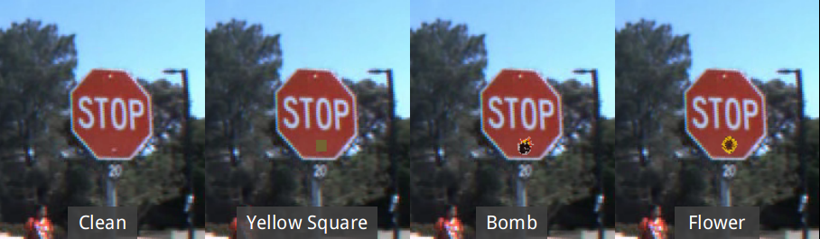
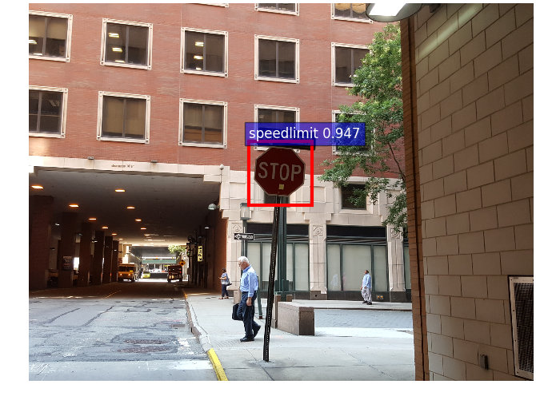

# Slide 5 — Poisoning and backdoors: change the data, keep the input

**Timing:** 10–13 minutes  
**Module:** From adversarial ML to attacks on LLMs

## On-slide content

```text
 clean training data ──────┐
                           ├──> TRAINING ──> MODEL ──> at test time:
 attacker's samples ───────┘
 (a few percent, labelled                     indiscriminate:  accuracy collapses for everyone
  as if they were clean)                      backdoor:        normal input   -> correct label
                                                               input + trigger -> attacker's label
```



*Gu, Dolan-Gavitt and Garg (2017): a clean stop sign and three backdoor triggers — a yellow square, a bomb, a flower*



*Gu, Dolan-Gavitt and Garg (2017): a real stop sign with the sticker, detected by the backdoored network as a speed limit at 0.947*

Build, one step per click:

0. The model learns whatever its training data says.
1. The attacker contributes a slice of that data: a public scrape, user feedback, outsourced training, a downloaded pre-trained model.
2. Indiscriminate poisoning: the filter becomes useless. SpamBayes failed with 1% of its training mail under attacker control.
3. Backdoor: the model passes every test, except when the trigger appears. A sticker on a stop sign reads as a speed limit.
4. The model you did not train yourself is a supply-chain artifact. BadNets named that problem in 2017.

| Variant | What the attacker wants | First shown |
| --- | --- | --- |
| Indiscriminate | Degrade the model for everyone | SpamBayes, 2008; SVMs, 2012 |
| Targeted / backdoor | Correct everywhere, wrong on a trigger | BadNets, 2017 |

> You cannot test your way out of a backdoor: the model is accurate on every input you think to try.

## Speaker notes

Nelson and colleagues poisoned SpamBayes in 2008 with a dictionary attack: spam containing many words common in legitimate mail, so the filter learns those words as spam indicators. Control of 1% of the training messages, 101 e-mails, rendered the filter unusable; a focused attack removed a chosen legitimate message from the victim's inbox 90% of the time. Biggio, Nelson and Laskov in 2012 made poisoning an optimization: gradient ascent on the SVM's test error to craft the injected points.

Gu, Dolan-Gavitt and Garg in 2017 built BadNets: a street-sign classifier with state-of-the-art accuracy that reads a stop sign as a speed limit when a small sticker is present, and showed the backdoor survived retraining for a new task. Their title is the point: the model supply chain. Training is outsourced, pre-trained models are downloaded and fine-tuned, and the person deploying the model did not see its data.

The LLM version exists too. Carlini and colleagues showed in 2023 that poisoning web-scale training datasets is practical — buying expired domains the datasets still point to — and Hubinger and colleagues in 2024 trained backdoored language models whose trigger behaviour survived safety training.

Hold two threads. Poisoning the training data has a cousin we meet later: poisoning the text a model reads at run time. And "the model you downloaded" returns as the supply chain of tools and models.

## Transition

“By 2013 the targets were ours: machine-learning malware detectors.”

## Sources

- [Nelson et al., Exploiting Machine Learning to Subvert Your Spam Filter, LEET (2008)](https://www.usenix.org/legacy/event/leet08/tech/full_papers/nelson/nelson.pdf)
- [Biggio, Nelson and Laskov, Poisoning Attacks against Support Vector Machines, ICML (2012)](https://arxiv.org/abs/1206.6389)
- [Gu, Dolan-Gavitt and Garg, BadNets: Identifying Vulnerabilities in the Machine Learning Model Supply Chain (2017)](https://arxiv.org/abs/1708.06733)
- [Carlini et al., Poisoning Web-Scale Training Datasets is Practical (2023)](https://arxiv.org/abs/2302.10149)
- [Hubinger et al., Sleeper Agents: Training Deceptive LLMs that Persist Through Safety Training (2024)](https://arxiv.org/abs/2401.05566)
