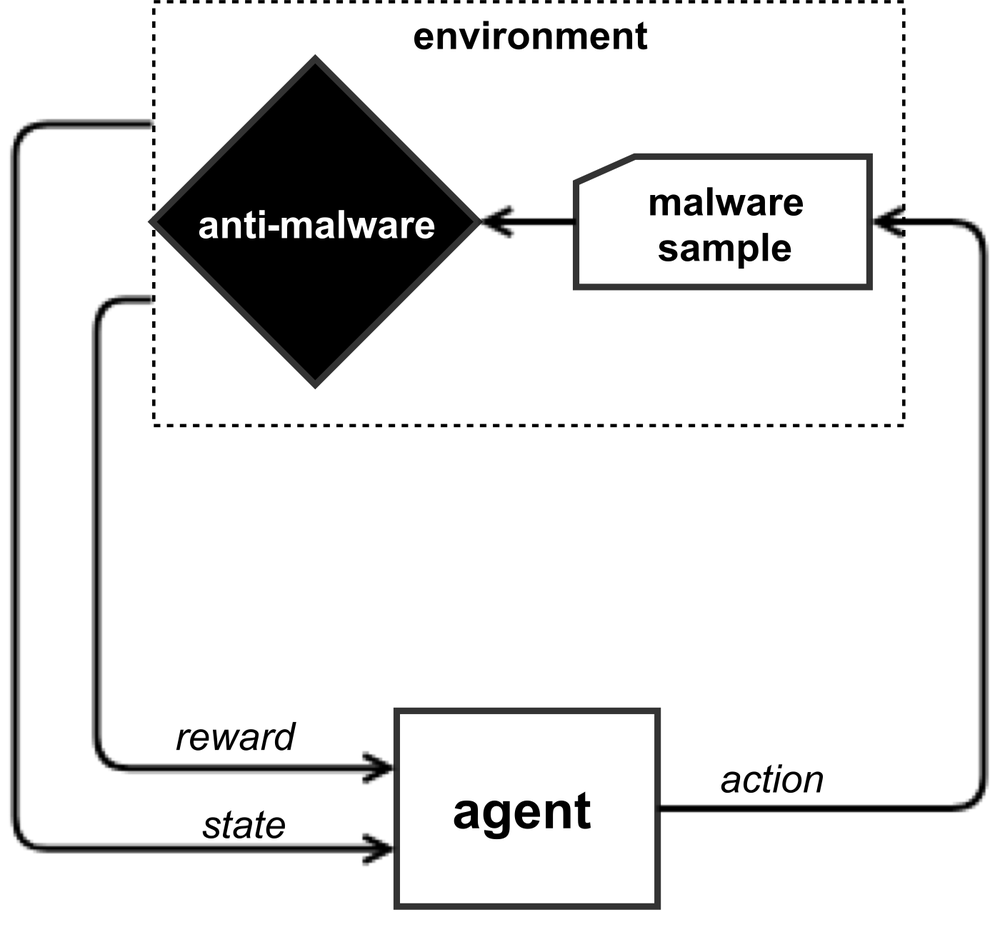
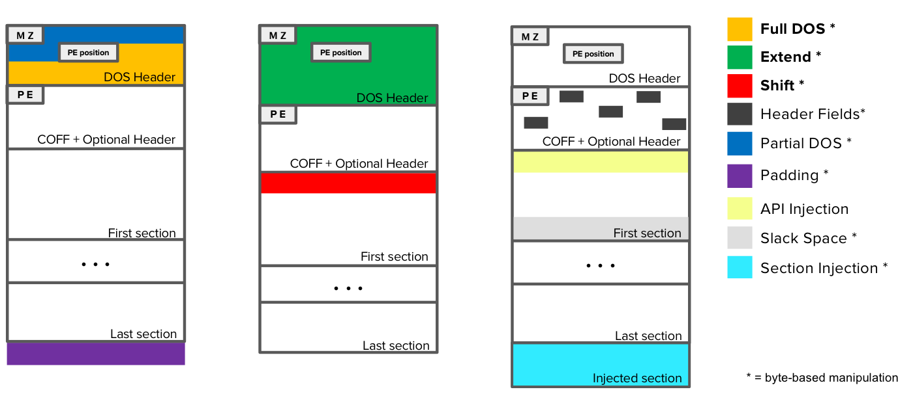

# Slide 6 — ...and it reached malware detection

**Timing:** 13–16 minutes  
**Module:** From adversarial ML to attacks on LLMs

## On-slide content

Machine-learning malware detectors — engineered-feature and raw-byte models — are themselves attackable.

```text
take a working malicious file
  -> append bytes, pad or add sections, adjust imports, re-pack
    -> keep it functional
      -> flip the classifier's verdict to "benign"
```



*Figure 1 of Anderson et al. (2018): the evasion loop as reinforcement learning — the policy, which the paper calls the agent, edits the malware sample, the anti-malware model scores it, and the score returns as reward and state*



*Demetrio et al. (2021): the practical problem-space manipulations of a Windows PE — header fields, DOS-header rewrites, section shift and extend, padding, slack space, section and API injection — each preserving execution*

Build, one step per click:

0. Start from a working malicious file.
1. Feature space: move the EMBER-style numbers until the score crosses the line. Easy — and not necessarily a real file.
2. Problem space: change the actual file so it still runs, is still malicious, and now scores "benign." Reinforcement learning found such edits in 2018.

| Attack space | What it changes |
| --- | --- |
| Feature space | Perturb EMBER-style features until the score crosses the line |
| Problem space | Modify the real PE so it still runs and still evades |

> Evading a model is an old game. The arms race did not start with LLMs.

## Speaker notes

Bring it home to malware. The first practical case was PDF malware: Biggio and colleagues evaded a PDF detector with gradient descent in 2013, and Šrndić and Laskov evaded PDFrate, a deployed system, as outsiders in 2014. Static machine-learning detectors — engineered PE features, raw-byte models — have a documented evasion failure: researchers used reinforcement learning to append and restructure bytes until a detector flipped, while keeping the sample functional. The figure's "agent" is the reinforcement-learning word for the policy that chooses the next edit; say so, and say that what this lecture will mean by an agent comes later, once the harness is on the table. Distinguish feature-space attacks (move the numbers) from the harder problem-space attacks (change the actual file and keep it valid and malicious). This is still "attack the model through its input." The LLM shift, two slides on, changes the kind of attack rather than just the target.

## Transition

“One more thing a model gives away — not its verdicts, but its training data. That is where this story reaches LLMs.”

## Sources

- [Anderson et al., Learning to Evade Static PE ML Malware Models via Reinforcement Learning (2018)](https://arxiv.org/abs/1801.08917)
- [EMBER: an open dataset for training static PE malware ML models (2018)](https://arxiv.org/abs/1804.04637)
- [Šrndić and Laskov, Practical Evasion of a Learning-Based Classifier: A Case Study, IEEE S&P (2014)](https://doi.org/10.1109/SP.2014.20)
- [Demetrio et al., Adversarial EXEmples: A Survey and Experimental Evaluation of Practical Attacks on Machine Learning for Windows Malware Detection (2021)](https://arxiv.org/abs/2008.07125)
