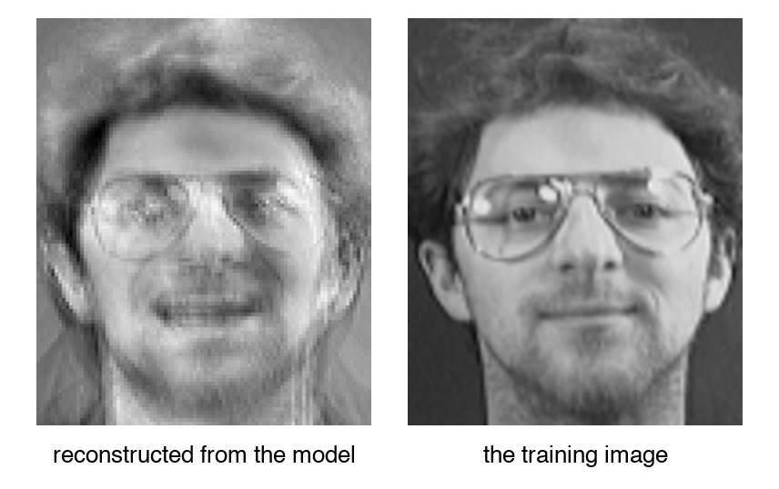
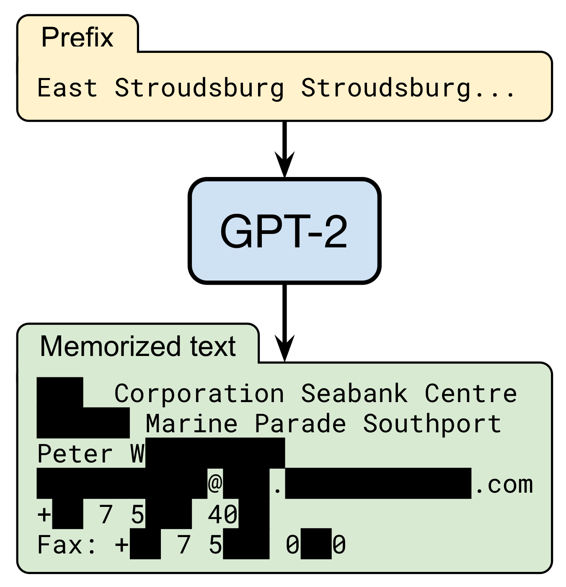

# Slide 7 — Membership inference and inversion: what the model remembers

**Timing:** 16–18 minutes  
**Module:** From adversarial ML to attacks on LLMs

## On-slide content

```text
 training set D ──> TRAINING ──> MODEL ──> prediction + confidence
                                              |
  membership inference   "was this record in D?"
      seen data gets more confident answers; the attacker's shadow models learn to spot it
  model inversion        "what did the training data look like?"
      climb the confidence for one label from noise -> a recognisable face
  training-data extraction, the LLM version   "repeat your training data"
      hundreds of verbatim sequences from GPT-2, names and phone numbers among them
```



*Figure 1 of Fredrikson, Jha and Ristenpart (2015): a face reconstructed from a recognition model's confidence scores, beside the training image*



*Figure 1 of Carlini et al. (2021): given a prefix, GPT-2 completes it with memorized text — a real person's name, address, e-mail and phone number, redacted here*

Build, one step per click:

0. A model trained on data it must not reveal: hospital records, faces, private text.
1. Membership: a record the model trained on gets a different answer from a new one. Shadow models trained by the attacker learn that difference from black-box access alone.
2. Inversion: start from noise, climb the confidence for one person's label. The result is their face.
3. In language models this becomes extraction: GPT-2 reproduced training sequences verbatim, each present in a single document. Larger models leaked more.

> A model is a lossy copy of its training data. The loss is smaller than its owners assume.

## Speaker notes

Shokri, Stronati, Song and Shmatikov in 2017 showed membership inference against models trained on Google's and Amazon's services, including a hospital discharge dataset: given a record and black-box access, decide whether it was in the training set. Overfitting is the main driver — the model is more confident on what it has seen. Fredrikson, Jha and Ristenpart in 2015 inverted a face-recognition model, reconstructing recognizable faces from confidence scores; Fredrikson and colleagues had recovered genetic markers from a drug-dosing model in 2014.

Carlini and colleagues in 2021 carried this into language models: hundreds of verbatim training sequences extracted from GPT-2, including personally identifiable information, with larger models more vulnerable than smaller ones. This is the first point where the history touches LLMs, and it is the same lesson: the outputs carry the data.

Hold for the bridge: none of these attacks needs anything but the model's answers.

## Transition

“LLMs add a new failure, and it is a very old one wearing new clothes.”

## Sources

- [Shokri et al., Membership Inference Attacks against Machine Learning Models, IEEE S&P (2017)](https://arxiv.org/abs/1610.05820)
- [Fredrikson, Jha and Ristenpart, Model Inversion Attacks that Exploit Confidence Information and Basic Countermeasures, CCS (2015)](https://doi.org/10.1145/2810103.2813677)
- [Fredrikson et al., Privacy in Pharmacogenetics, USENIX Security (2014)](https://www.usenix.org/conference/usenixsecurity14/technical-sessions/presentation/fredrikson_matthew)
- [Carlini et al., Extracting Training Data from Large Language Models (2021)](https://arxiv.org/abs/2012.07805)
