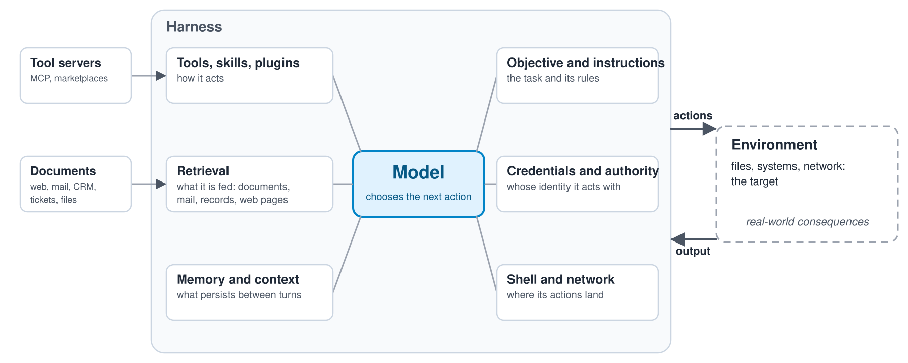

# Slide 12 — The harness: what surrounds the model

**Timing:** 30–33 minutes  
**Module:** From model to agent

## On-slide content

```text
model capability
    + tool interfaces
    + shell/network access
    + credentials
    + persistent or recoverable state
    + environmental feedback
    + delegated authority
    = real-world consequences
```



*The harness: everything around the model. The model chooses the next action; the six components around it decide what it can read, do, remember and act as.*

Build, one step per click:

0. The harness is everything the model runs inside. The model only chooses the next action.
1. An objective and instructions set the task and its rules.
2. Tools, skills and plugins let it act — and they come from tool servers and marketplaces it did not write.
3. Shell and network access carry its actions into the environment, and the output comes back. This is where consequences happen.
4. Retrieval feeds it documents, mail, records and web pages: content written by other people.
5. Memory and context keep state between turns and between tasks.
6. Credentials and delegated authority decide whose identity every action carries.

## Speaker notes

The model is one component in a larger execution system. Ask not only “What can the model reason about?” but also:

- What actions can it request?
- Which actions execute without independent authorization?
- What identity do those actions inherit?
- What observations return to the model?
- Where is state retained?

This framing applies whether the system attacks, writes code, or responds to incidents.

## Transition

“Put the model and the harness together with a loop, and you have something that acts.”

