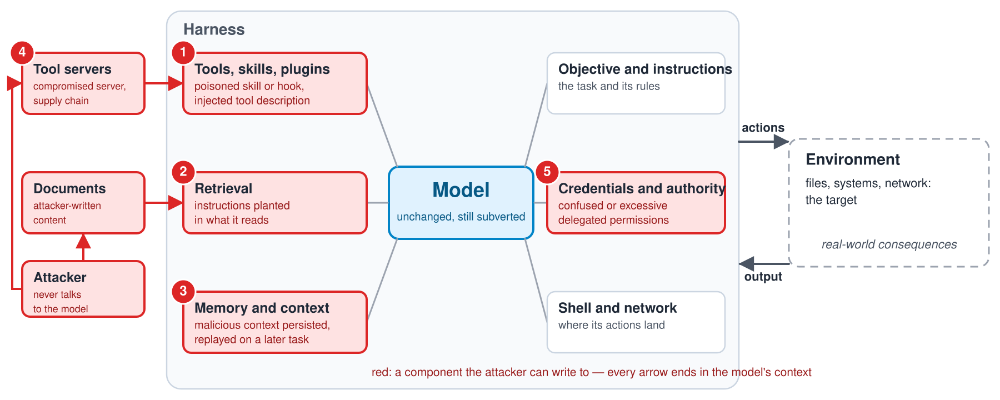

# Slide 14 — Attacks on the harness

**Timing:** 36–39 minutes  
**Module:** From model to agent

## On-slide content

An agent is a model plus a harness. The model is one component; the harness is the rest — and the larger attack surface.

*The same harness, with the components the attacker can write to in red. The model is unchanged; the attacker never talks to it.*

Build, one step per click:

0. The same picture as two slides ago. The model stays unchanged throughout.
1. ① Tools, skills, plugins, hooks: a poisoned skill, a tool description carrying injection, or a settings hook that runs when the agent starts — invoked in good faith.
2. ② Retrieval: instructions planted in a document, mail or record the agent will fetch.
3. ③ Memory and context: malicious context persisted, then replayed on a later, unrelated task.
4. ④ Tool servers: a compromised server in the agent's supply chain.
5. ⑤ Credentials and authority: confused or excessive delegation turns an injection into consequences.
6. The attacker never talks to the model. Every red arrow ends in the model's context — the indirect injection of slide 10, now with a map.

| Harness component | How it is attacked |
| --- | --- |
| Tools, skills, plugins, hooks | A poisoned or hijacked skill; a tool whose description carries injection; a configuration hook that runs a command when the agent starts |
| Retrieval (RAG) | Instructions planted in the documents the agent will fetch |
| Memory and context | Malicious context persisted and replayed later |
| Tool servers (MCP) | A compromised server in the agent's supply chain |
| Credentials and authority | Confused or excessive delegated permissions |

> A perfectly aligned model is still subverted through its tools, its memory, and its context.

## Speaker notes

Make "poisoned skill" concrete: a skill or plugin the agent is given — installed from a marketplace, or a tool definition it loads — that carries hidden instructions or malicious behavior, which the model then invokes in good faith. Tool poisoning: the tool's metadata or output is attacker-controlled and carries injection. Memory poisoning: injected context persists and fires on a later, unrelated request. MCP supply chain: a tool server the agent connects to is malicious or compromised. The through-line from the code/data slide is that every one of these feeds the data channel into the instruction channel. This is why "fix the model" is not enough — the harness is where most real attacks land.

## Transition

“That is the surface. Now the two ways an agent actually turns into an attacker.”
